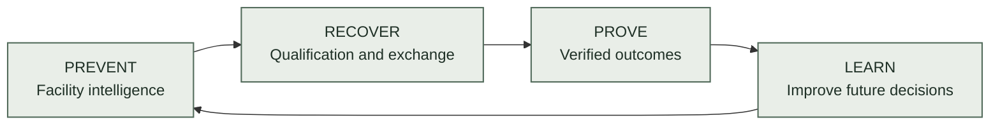
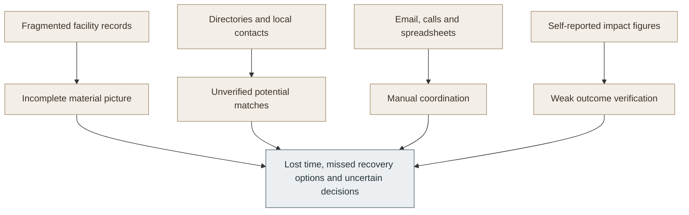
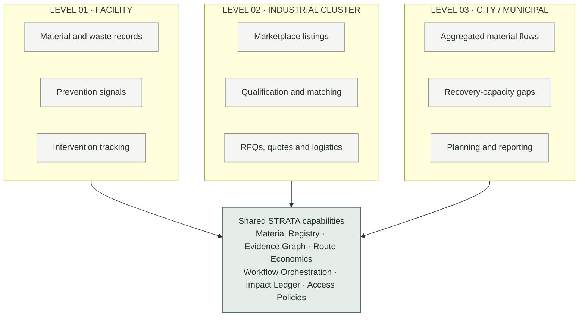
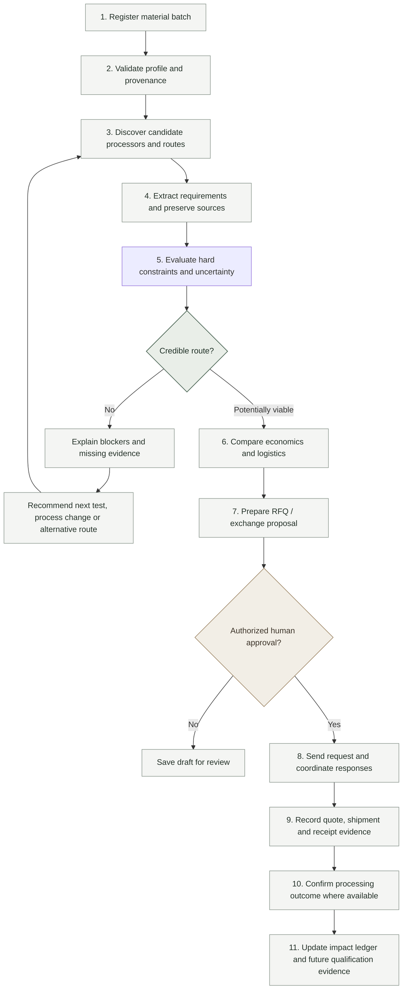
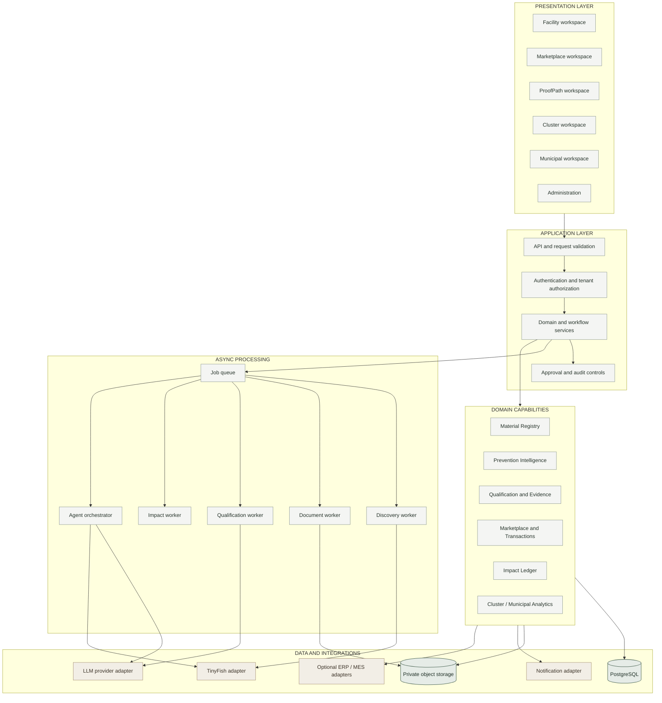
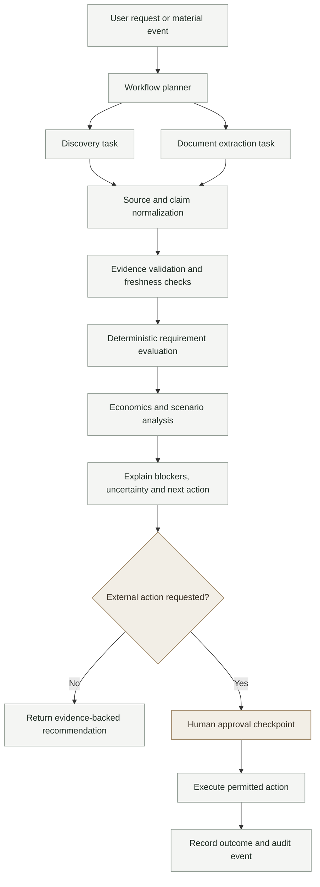
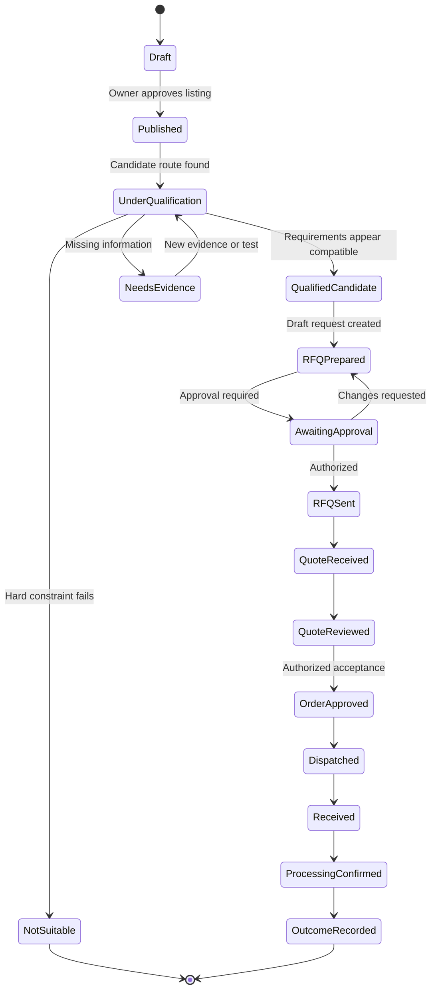
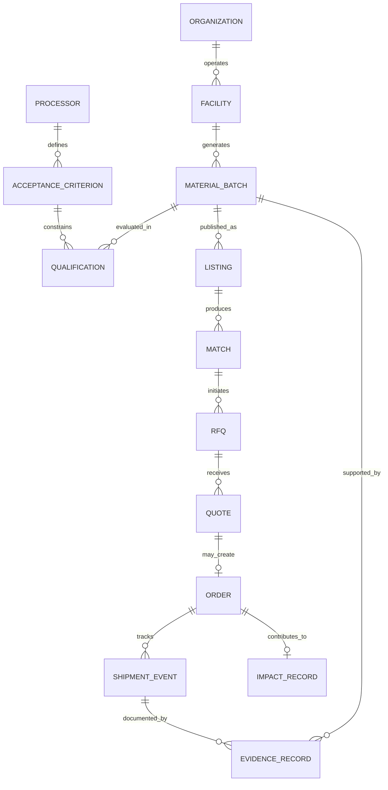

<div align="center">

# STRATA

### Industrial Circularity Operating System

**Prevent avoidable waste. Recover value from unavoidable byproducts. Verify what actually happens.**

A unified intelligence and execution platform connecting industrial facilities, material recovery networks, and city-level circularity planning.

<br/>

[Product Overview](#1-product-overview) · [System Architecture](#7-system-architecture) · [Core Workflows](#5-how-strata-works) · [Technology](#8-technology-stack) · [Roadmap](#14-roadmap)

<br/>

</div>

---

## Contents

- [1. Product Overview](#1-product-overview)
- [2. The Problem](#2-the-problem)
- [3. The STRATA Approach](#3-the-strata-approach)
- [4. Three Levels of Circularity](#4-three-levels-of-circularity)
- [5. How STRATA Works](#5-how-strata-works)
- [6. Core Product Modules](#6-core-product-modules)
- [7. System Architecture](#7-system-architecture)
- [8. Technology Stack](#8-technology-stack)
- [9. AI, Research and Evidence Architecture](#9-ai-research-and-evidence-architecture)
- [10. Marketplace and Transaction Lifecycle](#10-marketplace-and-transaction-lifecycle)
- [11. Interfaces and User Roles](#11-interfaces-and-user-roles)
- [12. Data, Trust and Governance](#12-data-trust-and-governance)
- [13. Unique Value Proposition](#13-unique-value-proposition)
- [14. Roadmap](#14-roadmap)
- [15. Repository Structure](#15-repository-structure)
- [16. Local Development](#16-local-development)
- [17. Implementation Status](#17-implementation-status)
- [18. Product Principles](#18-product-principles)
- [19. Contributing](#19-contributing)
- [20. License](#20-license)

---

## 1. Product Overview

STRATA is an industrial circularity platform designed to help organizations make better decisions about material loss, industrial byproducts, recovery pathways, and verified outcomes.

Most organizations manage these activities across disconnected spreadsheets, local relationships, email threads, technical documents, waste vendors, and reporting tools. STRATA brings these workflows into one system: it helps a facility understand where waste may be preventable, helps a material owner investigate credible recovery options, coordinates qualified exchanges between organizations, and records what ultimately happened to the material.

STRATA is designed around three connected levels:

| Level | Scope | Primary outcome |
|---|---|---|
| **01 — Facility** | Manufacturers and material-generating facilities | Identify waste-prevention opportunities and improve material utilization |
| **02 — Industrial cluster** | Generators, processors, recyclers, aggregators and logistics partners | Discover, qualify and coordinate byproduct exchanges |
| **03 — City / municipality** | Municipal corporations and authorized planning stakeholders | Understand aggregated material flows, recovery capacity and circularity gaps |

### The operating model



**Core principle:** the objective is not to maximize the number of marketplace listings. It is to improve the quality of material decisions and help organizations move from a plausible opportunity to a qualified, documented outcome.

> **Current scope note:** This repository is an initial architecture scaffold. The product vision and module boundaries described here are the intended system design; they should not be interpreted as a claim that every workflow or integration is already implemented.

---

## 2. The Problem

Industrial circularity is not simply a discovery problem. It is a connected set of operational, technical, commercial and verification problems.

### 2.1 Waste prevention is difficult to operationalize

Facilities may record scrap, rejects, offcuts, sludge, packaging, process residues or other byproducts, but the data is often fragmented across production records, stores, spreadsheets and disposal documents. Even when waste is measured, it may be difficult to connect it to a process, recurring cause, intervention or measurable result.

### 2.2 A potential buyer is not necessarily a viable destination

A processor may handle a material category in general while rejecting a specific batch because of composition, contamination, moisture, form factor, minimum quantity, location, certification requirements or inconsistent supply.

A directory match is therefore only a lead. A useful decision needs to explain:

- Which material attributes are known and which are missing?
- What does the receiving processor actually accept?
- Which requirements are supported by evidence?
- What is uncertain or incompatible?
- What test, sorting step or process change could change the outcome?
- What are the estimated costs, logistics constraints and commercial conditions?

### 2.3 Exchanges involve coordination, not just discovery

A viable exchange can require sampling, testing, documentation, aggregation, storage, transport, quote comparison, approvals, shipment coordination and confirmation of receipt. These steps are frequently handled manually across organizations.

### 2.4 Impact claims need a defensible evidence trail

A listing, an RFQ or a planned shipment does not prove that a material was reused or recycled. Credible reporting requires records of what was dispatched, received and processed, plus a transparent methodology for any environmental calculations.

### The gap



STRATA is designed to connect these disconnected steps into a consistent workflow.

---

## 3. The STRATA Approach

STRATA combines material intelligence, evidence-backed qualification, a permissioned industrial marketplace and outcome verification.

### 3.1 Prevent

Identify potential waste hotspots and opportunities to improve material utilization using facility records and production context where available. Track proposed interventions and compare outcomes against a defined baseline.

### 3.2 Recover

Create a structured material profile, discover candidate destinations, compare actual acceptance requirements, identify blockers, estimate route economics and coordinate approved exchanges.

### 3.3 Prove

Track the material through dispatch, receipt and processing evidence. Preserve the provenance of claims and calculate impact using explicit, versioned assumptions.

### 3.4 Learn

Use verified outcomes, processor feedback, failed qualifications, testing results and actual logistics costs to improve future recommendations. Learning must respect organization permissions and data-use agreements.

### What STRATA is — and is not

| STRATA is | STRATA is not |
|---|---|
| A circularity workflow and decision-support platform | Merely a directory of recyclers |
| A marketplace with technical qualification and execution support | An open listing board with unverified claims |
| An evidence-first research and recommendation system | An LLM answer presented as fact |
| A facility, cluster and municipal intelligence layer | A default cross-company data-sharing system |
| An outcome ledger with transparent impact methodology | A system that treats a planned shipment as verified impact |

---

## 4. Three Levels of Circularity

The three levels share common capabilities, but each has its own users, permissions, decisions and outputs.

### Level 01 — Facility intelligence

**Purpose:** reduce avoidable material loss before looking for an external destination.

**Users:** manufacturers, plant managers, sustainability teams, production engineers, EHS teams and material controllers.

**Capabilities**
- Maintain material, batch, process-origin and waste records.
- Capture quantity, unit, composition, contamination, timing and provenance.
- Identify recurring waste categories and candidate hotspots when the available data supports it.
- Connect observations to potential causes for human investigation.
- Record prevention interventions, owners, dates and expected results.
- Compare measured post-intervention results with a documented baseline.
- Route unavoidable byproducts into the recovery workflow.

**Output:** a clearer view of where material is lost, what may be preventable, and which residual materials need qualified recovery routes.

**Important distinction:** a statistical association is not proof of a cause. STRATA should surface signals and supporting data, while users validate the operational explanation.

### Level 02 — Industrial-cluster marketplace

**Purpose:** coordinate material exchange across a network of industrial organizations.

**Users:** material generators, processors, recyclers, aggregators, logistics partners and industrial-cluster operators.

**Marketplace capabilities**
- Publish and manage permissioned material listings.
- Search by material attributes, location, quantity, timing and documented requirements.
- Match listings to candidate processors and recovery routes.
- Compare candidate matches by technical fit, evidence quality, logistics and estimated economics.
- Record processor acceptance criteria, capacity claims and validity dates.
- Prepare requests for information and requests for quotation (RFIs/RFQs).
- Compare submitted quotes, lead times, conditions and logistics options.
- Support approval-gated order, dispatch, receipt and processing workflows.
- Coordinate aggregation or shared logistics when quantities, timing, compatibility and economics support it.
- Preserve rejection reasons and feedback to improve future qualification.

**Output:** a more structured path from material availability to a qualified, approved and traceable exchange.

**Marketplace principle:** the platform should not imply that a match is confirmed, that a processor has capacity, or that a transaction is complete until the relevant evidence or confirmation exists.

### Level 03 — City and municipal intelligence

**Purpose:** support planning through permissioned, aggregated material-flow and recovery-capacity insights.

**Users:** municipal corporations, authorized planning teams, industrial development bodies and approved cluster coordinators.

**Potential capabilities**
- View aggregated material generation and recovery patterns where reliable data is available.
- Identify material categories or geographies with limited recovery options.
- Compare reported generation with known processing or recovery capacity.
- Explore scenarios for collection, aggregation, infrastructure or partnership interventions.
- Monitor documented outcomes across approved programs.
- Export reports with data coverage, limitations and methodology notes.

**Output:** a decision-support view for identifying circularity gaps and prioritizing further investigation or intervention.

Municipal intelligence is a distinct governance and data-sharing layer. It must not expose a company's raw material records by default. The quality of city-level insights depends on participation, data coverage, permissions and validation.

### Shared capability model



---

## 5. How STRATA Works

The primary recovery workflow begins with a real material batch and ends with a documented outcome or a clearly stated blocker.



### The qualification result should be actionable

A useful result is not just a compatibility score. It should contain:

1. **Decision status:** incompatible, insufficient evidence, potentially viable, or verified against defined requirements.
2. **Requirement comparison:** each requirement, observed value, source and status.
3. **Hard blockers:** constraints that currently prevent a route from qualifying.
4. **Unknowns:** missing values, stale claims or unverified capacity.
5. **Next-best action:** a specific sample, test, document, process change or human confirmation.
6. **Route economics:** estimated net value with assumptions, cost components and uncertainty.
7. **Evidence trail:** source records and timestamps that explain the conclusion.

The system must distinguish a route that appears promising from one that a processor has explicitly accepted.

---

## 6. Core Product Modules

### 6.1 Material Registry

The common material data layer for facilities, batches, listings and outcomes.

- Material type, composition and process origin
- Quantity, unit, batch and availability window
- Physical form, contamination and relevant test results
- Facility/region information subject to permissions
- Documents, measurements and provenance
- Version history for profile changes

### 6.2 Waste Prevention Intelligence

Turns material and production records into opportunities for investigation and measured improvement.

- Waste category and trend analysis
- Potential hotspot identification
- Candidate cause and process-context exploration
- Intervention register and ownership
- Baseline-versus-outcome tracking
- Separation of observed facts, hypotheses and confirmed causes

### 6.3 ProofPath Qualification

The evidence-backed qualification workflow for determining whether a material could meet a recipient's requirements.

- Processor requirement extraction from available sources and documents
- Attribute-level comparison between material and requirements
- Hard-constraint evaluation
- Evidence-linked blockers and uncertainty
- Missing-test and missing-document identification
- Counterfactual analysis: what would need to change for a route to become viable?
- Recommended verification steps
- Versioned qualification history

### 6.4 Industrial Marketplace

The coordination layer for byproduct exchange.

- Organization profiles and controlled visibility
- Material listings and search
- Candidate match review
- Processor criteria and capacity records
- RFI/RFQ drafting and response management
- Quote comparison and approval checkpoints
- Order, shipment and receipt state
- Optional aggregation and shared-logistics workflows
- Dispute, rejection and exception records

### 6.5 Route Economics and Optimization

Compares feasible pathways using transparent assumptions rather than a score alone.

Potential cost/value dimensions include:
- Material preparation, sorting and testing
- Packaging and handling
- Transport and distance
- Minimum lot size and aggregation
- Processor fees or quoted purchase price
- Storage and timing constraints
- Expected yield and residual disposal
- Confidence in each input

Where reliable inputs are available, STRATA can compare scenarios such as direct recovery, preprocessing, aggregation or an alternative destination. Estimated economics are not a quote and must be labeled accordingly.

### 6.6 TinyFish Discovery

A provider adapter for bounded external discovery workflows.

- Search for candidate processors and relevant technical information
- Retrieve and normalize source-backed results through the supported provider API
- Preserve source URL, retrieval time and extraction status
- Identify missing or conflicting information for review
- Keep provider-specific implementation isolated from domain logic

TinyFish is an integration, not a truth source. Discovered content remains untrusted until validated under STRATA's evidence rules. The exact adapter behavior depends on the provider's current API, permissions and available capabilities.

### 6.7 Evidence and Claim Graph

Represents the relationship between claims, sources, material attributes, processor requirements and decisions.

Example:
- Claim: a processor accepts a specified material category.
- Evidence: a dated processor page or supplied technical specification.
- Scope: applicable material type, region, process or facility.
- Status: source-supported, user-supplied, verified, inferred or stale.
- Decision use: supports a candidate match, but may not establish current capacity or acceptance of a specific batch.

### 6.8 Verified Impact Ledger

Records the evidence needed to distinguish a planned exchange from an actual outcome.

- Dispatch, receipt and processing events
- Quantities and unit normalization
- Destination and material pathway
- Supporting documents or confirmations
- Methodology version and calculation inputs
- Estimated versus verified outcome status
- Duplicate-event controls and audit history

### 6.9 Cluster Intelligence

- Permissioned shared-opportunity view
- Potential compatible supply and demand
- Aggregation candidates and logistics coordination
- Material-flow summaries
- Recovery-capacity gaps
- Cluster-level outcome reporting

### 6.10 Municipal Intelligence

- Approved aggregate material-flow indicators
- Recovery and processing-capacity mapping where supported by data
- Data coverage and quality indicators
- Scenario exploration and intervention tracking
- Exportable reports with assumptions and limitations

---

## 7. System Architecture

### 7.1 Logical architecture



### 7.2 Architectural approach

The initial recommendation is a **modular monolith with asynchronous workers**.

This provides:
- Clear boundaries between product domains
- One primary API deployment to simplify early development
- Separate execution for slow or retryable jobs
- Easier end-to-end testing
- A path to split components later if scale, reliability or team ownership justifies it

The folder structure allows the team to evolve modules independently without requiring every module to become a microservice immediately.

### 7.3 Request and job boundaries

**Synchronous API requests** should handle operations that need an immediate, bounded response: validation, listing updates, access checks, approval recording and status retrieval.

**Asynchronous jobs** should handle work that may take longer or fail independently: external discovery, document parsing, large qualification runs, notification delivery and impact recalculation.

Every job should have a stable identifier, status, timestamps, retry policy and structured failure information. Jobs that create external side effects must be idempotent or guarded against duplicate execution.

### 7.4 System boundaries

| Boundary | Responsibility |
|---|---|
| Web application | User interaction and presentation; no privileged vendor secrets |
| API | Authentication, authorization, validation, orchestration and audit events |
| Domain modules | Business rules and state transitions |
| Workers | Long-running, retryable workflows |
| Integration adapters | Provider-specific API contracts and error handling |
| Database | Durable domain records, relationships and transactional consistency |
| Object storage | Private technical documents and supporting evidence |
| Analytics layer | Permissioned, aggregated views with defined calculation methods |

---

## 8. Technology Stack

The following is the **proposed stack for the initial implementation**. Specific versions, libraries and deployment choices should be finalized in dependency manifests as implementation begins.

```mermaid
flowchart LR
    subgraph FRONT["FRONTEND"]
      F1["Next.js"]
      F2["TypeScript"]
      F3["Role-based workspaces"]
    end

    subgraph BACK["BACKEND"]
      B1["Python"]
      B2["FastAPI"]
      B3["Pydantic schemas"]
      B4["Domain services"]
    end

    subgraph ASYNC["ASYNC AND AI"]
      C1["Redis-backed queue"]
      C2["Workflow orchestrator"]
      C3["TinyFish adapter"]
      C4["LLM adapter"]
    end

    subgraph STORE["PERSISTENCE"]
      S1[("PostgreSQL")]
      S2[("Private object storage")]
    end

    FRONT --> BACK
    BACK --> STORE
    BACK --> ASYNC
    ASYNC --> STORE

    classDef tech fill:#f4f5f3,stroke:#87938a,color:#26332a,stroke-width:1px;
    classDef persistence fill:#e6ece7,stroke:#526b5b,color:#1f3026,stroke-width:1.3px;
    class FRONT,BACK,ASYNC tech;
    class STORE persistence;
```



| Layer | Proposed technology | Intended role |
|---|---|---|
| Web application | Next.js, TypeScript | Role-aware interfaces and workflows |
| API | Python, FastAPI | Versioned REST API and application orchestration |
| Validation | Pydantic | Request and response validation |
| Relational storage | PostgreSQL | Organizations, facilities, batches, listings, transactions and audit records |
| Geospatial capability | PostGIS, if required | Distance and location-aware queries |
| Async jobs | Redis plus a task queue | Discovery, parsing, qualification and recalculation jobs |
| AI assistance | Provider-agnostic LLM adapter | Structured extraction, summaries and explanations |
| Web discovery | TinyFish adapter | External discovery workflows, subject to supported provider API |
| Document storage | S3-compatible or equivalent private object storage | Technical sheets, evidence files and attachments |
| Containers | Docker / Docker Compose | Reproducible local dependencies |
| Testing | Pytest and frontend test tooling | Domain, integration and contract validation |
| Observability | Structured logs, metrics and tracing | Diagnose job failures, latency and workflow outcomes |

### Technology selection principles

- Prefer reliable, inspectable workflows over unnecessary architectural complexity.
- Keep external providers behind adapters so they can be replaced.
- Keep qualification rules testable without calling an LLM.
- Use explicit schema and migration management for persistent data.
- Do not introduce a vector database, graph database or microservice platform until a demonstrated requirement justifies it.
- Treat a technology listed here as a design choice, not evidence that its integration is complete.

---

## 9. AI, Research and Evidence Architecture

STRATA uses AI to accelerate research and structured reasoning, but business-critical conclusions must remain traceable and constrained by explicit rules.

### 9.1 Bounded workflow model



### 9.2 Separation of responsibilities

| Component | Responsibility | Must not do |
|---|---|---|
| Discovery workflow | Find candidate sources and relevant information | Treat every search result as accurate or current |
| Document extraction | Extract attributes and requirements with source locations | Invent values absent from the document |
| Evidence service | Track claims, source provenance, timestamps and status | Convert an unsupported claim into a verified fact |
| Qualification engine | Apply explicit hard constraints and explain mismatches | Allow a language model to override a hard failure |
| Economics engine | Compare routes using stated assumptions | Present estimates as confirmed quotes |
| Agent orchestrator | Coordinate bounded steps, tools, retries and approvals | Operate with unrestricted tools or make unapproved commitments |
| Impact service | Calculate outcomes from validated events and a defined method | Count planned or duplicate transactions as verified impact |

### 9.3 Evidence statuses

STRATA should use explicit provenance labels. The precise status model can evolve, but it should distinguish at least:

- `verified` — checked against a defined verification process.
- `source_supported` — supported by an identified source, but not necessarily independently confirmed.
- `user_supplied` — entered or asserted by an authorized user.
- `inferred` — derived from available information and not directly established.
- `synthetic_demo` — generated for demonstration or testing.

A source-supported statement that a processor accepts a material category does not necessarily prove current capacity, current pricing or acceptance of a particular batch.

### 9.4 Counterfactual qualification

When a batch fails a candidate route, STRATA should explain which changes could alter the decision.

Examples include:
- Sorting or separating mixed material streams
- Removing a contaminant
- Changing moisture or particle-size characteristics
- Obtaining a missing laboratory test
- Aggregating sufficient volume
- Providing a required technical document
- Choosing a different recipient or processing route

Recommendations must be tied to actual requirements and clearly labeled assumptions. STRATA should not imply that a treatment will work without adequate evidence.

### 9.5 Human approval boundaries

Human approval is required before high-impact external actions such as sending commercial RFQs, accepting quotes, confirming orders or making binding commitments. The system may prepare the action and explain its basis, but it must respect authorization and approval policy.

---

## 10. Marketplace and Transaction Lifecycle

The marketplace is a core part of Level 02, not a separate directory bolted onto the product.

### Listing-to-outcome lifecycle



The lifecycle is illustrative. Real implementation should define permitted transitions, required evidence, cancellation paths, expiry rules, exception handling and the authority allowed to perform each transition.

### Marketplace data should capture

- Listing owner and organization permissions
- Material profile, batch quantity, unit and availability window
- Required handling, testing or documentation
- Candidate recipients and the reason for each match
- Evidence and validity of recipient requirements
- RFQ versions, recipients, responses and approval history
- Quote terms, delivery assumptions and expiry
- Shipment, receipt and processing confirmations
- Rejection, cancellation and dispute reasons
- Audit events for material state changes

### Matching is multi-dimensional

A useful candidate match considers several independent factors:

1. Technical compatibility and hard constraints
2. Evidence coverage and freshness
3. Quantity, timing and minimum lot size
4. Geography and logistics feasibility
5. Preparation, testing and handling costs
6. Price, fees and expected recovery yield
7. Recipient capacity and confirmation status

A single composite score may help rank candidates, but the system should retain the underlying factors and must not hide a critical technical blocker behind a high score.

---

## 11. Interfaces and User Roles

STRATA is a multi-organization platform. The user interface should reflect each role's decisions and permissions while sharing a common material and evidence model.

| Interface | Primary users | Main tasks |
|---|---|---|
| Facility workspace | Manufacturers, plant teams, sustainability teams | Record batches, inspect waste signals, track interventions and publish selected material |
| Marketplace workspace | Generators, processors and recyclers | Discover listings, assess matches, manage RFQs and coordinate exchanges |
| ProofPath workspace | Technical teams, material owners, processors | Review requirements, evidence, blockers, tests and qualification decisions |
| Aggregator / logistics workflows | Aggregators and logistics providers | Assess compatible lots, coordinate consolidation and record logistics details |
| Cluster workspace | Industrial park or cluster operator | Review permissioned opportunities, shared logistics candidates and aggregate indicators |
| Municipal workspace | Authorized municipal/planning users | Review approved material-flow indicators, capacity gaps and intervention scenarios |
| Administration | STRATA operations and authorized administrators | Manage organizations, roles, integrations, audit and platform policies |

### Role-based access is a product feature

Access should be granted by organization, role, resource and action. A cluster operator should not automatically gain access to every participating company's raw records. Municipal views should use approved aggregation rules and show data coverage and limitations.

---

## 12. Data, Trust and Governance

Circularity decisions can affect commercial relationships, regulatory reporting and environmental claims. Trust must be designed into the system.

### 12.1 Core data entities



This is a conceptual relationship model, not a finalized database schema. The production schema must define organization ownership, foreign-key rules, state transitions, retention, deletion and audit requirements.

### 12.2 Governance requirements

- **Tenant isolation:** organization-owned records are scoped by tenant-aware authorization.
- **Explicit publication:** material owners choose which fields are shared through a listing.
- **Evidence provenance:** claims retain sources, retrieval timestamps and validation status.
- **Data minimization:** collect only what a workflow needs.
- **Auditability:** record approvals, state transitions, exports and sensitive administrative actions.
- **Retention controls:** define how long documents and operational records are kept.
- **Secure document processing:** validate and scan uploads, isolate parsers and treat embedded instructions as untrusted content.
- **Methodology transparency:** show assumptions and version information for impact calculations.
- **Permissioned analytics:** aggregate only where policy and data quality permit.

### 12.3 Environmental impact integrity

Impact metrics should distinguish:
- Material listed
- Material matched
- Material offered or quoted
- Material dispatched
- Material received
- Material confirmed as processed or recovered
- Estimated environmental benefit
- Benefit calculated from verified outcome evidence

These are different states and must not be presented interchangeably. Any emissions, water, energy or disposal-avoidance calculation needs a documented methodology, source factors, scope, assumptions and uncertainty.

---

## 13. Unique Value Proposition

### Why a marketplace alone is insufficient

A marketplace can improve discovery, but it cannot by itself establish whether a batch meets a recipient's technical requirements, whether a route is economically viable, whether a proposed intervention prevents waste, or whether the material was ultimately processed as intended.

STRATA combines these capabilities into one workflow.

| Capability | Basic directory / listing board | STRATA design objective |
|---|---|---|
| Discover possible recipients | Contact and category search | Source-backed candidate discovery |
| Evaluate technical fit | Often left to manual follow-up | Attribute-level requirements and blocker analysis |
| Handle uncertainty | Often implicit | Explicit missing evidence, freshness and confidence |
| Improve a rejected batch | Usually outside the directory | Counterfactual options and next verification steps |
| Compare route economics | External spreadsheet or negotiation | Transparent, assumption-based route comparison |
| Coordinate exchange | Messages and manual tracking | Approval-gated RFQs, quotes and transaction states |
| Prevent avoidable waste | Usually out of scope | Facility signals and intervention tracking |
| Verify outcomes | Often self-reported or fragmented | Evidence-linked dispatch, receipt and processing records |
| Support cluster planning | Limited to visible listings | Permissioned aggregate opportunities and capacity gaps |
| Support municipal planning | Separate reporting process | Aggregated intelligence where data and governance permit |

### The defensibility hypothesis

Over time, and only with appropriate permissions and validated records, STRATA may build a valuable operational knowledge base from:
- Material properties and their provenance
- Processor requirements and their changes over time
- Successful and failed qualification attempts
- Tests and interventions that changed feasibility
- Real quote and logistics information
- Receipt and processing confirmations
- Outcome evidence and methodology-linked impact calculations

This is a hypothesis to validate through real usage, not an automatic moat. Data quality, network participation, repeat workflow value and user trust determine whether this knowledge becomes defensible.

### Who is most likely to benefit first?

The strongest early users are likely to be organizations with recurring material streams, multiple destinations to evaluate, meaningful compliance or reporting needs, or repeated coordination costs: larger manufacturers, material aggregators, processors, brands managing multiple facilities and industrial-cluster operators.

A small business that already has a reliable local buyer and minimal documentation burden may not need a full platform. STRATA must demonstrate measurable value in time saved, material value recovered, waste avoided, risk reduced or evidence quality improved.

---

## 14. Roadmap

The roadmap should prioritize a complete, verifiable workflow before broad feature coverage.


### Phase 1 — Core vertical slice

- Material and batch registration
- Structured processor and requirement records
- TinyFish adapter with source preservation, subject to verified API access
- Evidence-backed qualification and hard-constraint checks
- Blocker explanation and next-best verification
- Initial route-economics model with explicit assumptions
- Synthetic, clearly labeled demonstration fixtures
- Tests for critical domain rules and tenant boundaries

### Phase 2 — Marketplace execution

- Permissioned listings and candidate matches
- RFQ drafting and approval
- Quote and condition comparison
- Transaction-state management
- Dispatch and receipt records
- Outcome evidence and audit history

### Phase 3 — Facility prevention

- Import or enter facility material/waste records
- Identify candidate hotspots when data quality permits
- Track interventions and baselines
- Compare measured results and route unavoidable byproducts into recovery

### Phase 4 — Industrial-cluster intelligence

- Organization sharing and cluster policies
- Aggregation and shared-logistics workflows
- Permissioned cluster opportunity view
- Material-flow summaries and recovery-capacity gaps

### Phase 5 — Municipal intelligence

- Authorized data-sharing agreements and aggregation policy
- Data coverage and quality assessment
- City-level flow and capacity indicators
- Scenario exploration and intervention reporting

### Validation metrics

Measure outcomes rather than feature count.

| Dimension | Example measurement |
|---|---|
| Research efficiency | Time required to assemble a processor dossier compared with a documented baseline |
| Evidence quality | Share of material requirements with traceable supporting evidence |
| Qualification quality | Agreement with technical reviewer decisions; false-positive rate for incompatible routes |
| Marketplace performance | Time from listing to qualified response; RFQ response rate |
| Commercial value | Net recovery value after preparation, testing and logistics costs |
| Prevention | Measured change against a defined waste baseline after an intervention |
| Outcome integrity | Share of reported recovery quantities supported by receipt/processing evidence |
| Reliability | Workflow completion rate, retry rate and time to recover from failed integrations |
| Adoption | Repeat usage and retention by participating organizations |

Do not publish targets as achieved results until they have been measured with a defined methodology and real observations.

---

## 15. Repository Structure

```text
strata/
├── apps/
│   ├── web/                         # Next.js / TypeScript user interfaces
│   │   └── src/
│   │       ├── app/                 # Facility, marketplace, ProofPath,
│   │       │                        # cluster, municipal and admin routes
│   │       ├── components/          # Shared UI primitives
│   │       ├── features/            # Product-specific frontend modules
│   │       ├── lib/                 # API client, session and utilities
│   │       └── types/
│   │
│   └── api/                         # FastAPI backend
│       ├── src/strata/
│       │   ├── api/v1/routers/      # Versioned API endpoints
│       │   ├── core/                # Configuration, auth and logging
│       │   ├── domain/              # Materials, prevention, marketplace,
│       │   │                        # qualification, impact and municipal
│       │   ├── services/            # Application use cases
│       │   ├── repositories/        # Persistence interfaces
│       │   ├── db/                  # Models and migrations
│       │   ├── schemas/             # Request/response contracts
│       │   └── workers/             # Background task entry points
│       └── tests/
│           ├── unit/
│           ├── integration/
│           └── contract/
│
├── services/
│   ├── agent-orchestrator/          # Bounded AI workflow coordination
│   ├── discovery-worker/            # External discovery jobs
│   ├── document-worker/             # Document extraction
│   ├── qualification-worker/        # Requirement comparison
│   └── impact-worker/               # Impact calculation
│
├── packages/
│   ├── contracts/                   # Shared data and event contracts
│   ├── ui/                          # Optional shared UI components
│   └── config/                      # Shared development configuration
│
├── integrations/
│   ├── tinyfish/                    # TinyFish provider adapter
│   ├── llm/                         # LLM provider abstraction
│   ├── object-storage/              # Private evidence documents
│   ├── notifications/               # Notification providers
│   └── erp-mes/                     # Optional industrial integrations
│
├── data/
│   ├── schemas/                     # Material profile and data schemas
│   ├── fixtures/                    # Synthetic demo data
│   └── reference/                   # Licensed, attributed reference data
│
├── infra/
│   ├── docker-compose.yml           # Local PostgreSQL and Redis
│   ├── docker/
│   ├── deployment/
│   ├── kubernetes/
│   ├── terraform/
│   └── monitoring/
│
├── docs/
│   ├── architecture/
│   ├── adr/                         # Architecture decision records
│   ├── product/
│   ├── security/
│   └── api/
│
├── scripts/
├── .github/
│   ├── ISSUE_TEMPLATE/
│   └── PULL_REQUEST_TEMPLATE.md
├── .env.example
├── .gitignore
└── README.md
```

The directory structure expresses intended module boundaries. Empty folders and README placeholders are scaffolding, not completed features.

---

## 16. Local Development

### Prerequisites

- Git
- Docker and Docker Compose
- Python version selected by the API dependency manifest
- Node.js version selected by the frontend package manifest

The initial scaffold contains a Compose configuration for PostgreSQL and Redis. Full frontend and backend dependency manifests, migrations and application workflows are implementation tasks.

### 1. Clone the repository

```bash
git clone YOUR_REPOSITORY_URL
cd strata
```

### 2. Configure environment variables

```bash
cp .env.example .env
```

Populate only the values required for your local setup. Do not commit `.env` or real credentials.

### 3. Start local dependencies

```bash
docker compose -f infra/docker-compose.yml up -d
```

This starts the configured PostgreSQL and Redis containers. It does not automatically create application tables or run database migrations.

### 4. Start implementing the API

The minimal API entry point is located at:

```text
apps/api/src/strata/main.py
```

Once the API dependency manifest is added, install dependencies in a virtual environment and run the application with the selected ASGI server. Add database migrations before relying on persistent domain data.

### 5. Implement the frontend

The frontend architecture is defined under:

```text
apps/web/src/
```

Add the Next.js package manifest, app configuration, route layouts, session handling and API client as the frontend implementation begins.

### 6. Configure external discovery

Add TinyFish credentials to your local environment only after confirming the provider's current API contract and access. Keep all provider-specific request and response handling in `integrations/tinyfish/`.

### Useful local commands

```bash
# Start local infrastructure
docker compose -f infra/docker-compose.yml up -d

# Inspect running services
docker compose -f infra/docker-compose.yml ps

# Stop local infrastructure
docker compose -f infra/docker-compose.yml down
```

---

## 17. Implementation Status

This repository begins as a design and code scaffold. Status should be updated as features are implemented and tested.

| Area | Current scaffold status |
|---|---|
| Product vision and architecture documentation | Documented |
| Repository/module boundaries | Created |
| Environment variable template | Created |
| PostgreSQL and Redis local Compose configuration | Created |
| Minimal FastAPI health endpoint | Scaffolded; API dependencies still need to be installed/configured |
| Material profile JSON Schema | Created |
| Frontend routes and UI | Planned directory structure; application screens not implemented |
| Database models and migrations | Not implemented |
| Authentication and tenant authorization | Architecture defined; implementation required |
| Marketplace listings, matching and RFQs | Architecture defined; implementation required |
| TinyFish integration | Adapter boundary documented; live API calls not implemented |
| AI orchestration and evidence graph | Architecture defined; workflows not implemented |
| Qualification and route economics | Domain design described; engine not implemented |
| Facility prevention analytics | Product design described; implementation required |
| Verified impact ledger | Domain design described; implementation required |
| Cluster and municipal interfaces | Architecture defined; implementation required |
| Production deployment and monitoring | Directories prepared; configuration and validation required |

A feature should be marked complete only when its implementation, authorization behavior, failure handling and relevant tests have been reviewed.

---

## 18. Product Principles

### Evidence over fluency

A polished explanation is not a substitute for source-backed evidence. Preserve the difference between facts, claims, inferences and assumptions.

### Prevention before diversion

The preferred outcome is not always to find a destination for waste. When feasible, preventing avoidable material loss should be evaluated before external recovery.

### Qualification before transaction

A potential match must pass the relevant technical and operational checks before the platform encourages commercial execution.

### Human control over consequential actions

Automation should reduce repetitive research and coordination while leaving high-impact decisions with authorized people.

### Outcomes over activity

Listings, matches, RFQs and shipments are workflow events. They are not interchangeable with verified reuse, recycling or environmental benefit.

### Privacy by design

Cross-company collaboration requires explicit permissions, careful aggregation and clear data ownership.

### Modular expansion

Textiles may be a useful initial material focus, but expansion into other industrial byproducts should use material-specific qualification modules built on shared platform capabilities. Each new material category needs appropriate acceptance criteria, evidence sources, handling requirements and validation.

---

## 19. Contributing

Contributions should preserve the separation between domain rules, external providers, user interfaces and background workflows.

Before submitting a change:

- Explain the user or operational problem being solved.
- Add or update tests for qualification rules and state transitions.
- Verify organization-level access controls for affected resources.
- Preserve source provenance and evidence status.
- Document new assumptions, calculations and external dependencies.
- Confirm that retries cannot duplicate transactions or impact events.
- Never commit credentials, customer records or confidential documents.

Use the repository's issue and pull-request templates to describe changes and validation.

---

## 20. License

No license has been selected in this scaffold. Until a license is added, do not assume that the code is available for unrestricted reuse. Add a `LICENSE` file once the project owners have chosen the intended terms.

---

<div align="center">

**STRATA**

*From material loss to qualified recovery and verified circularity.*

</div>
